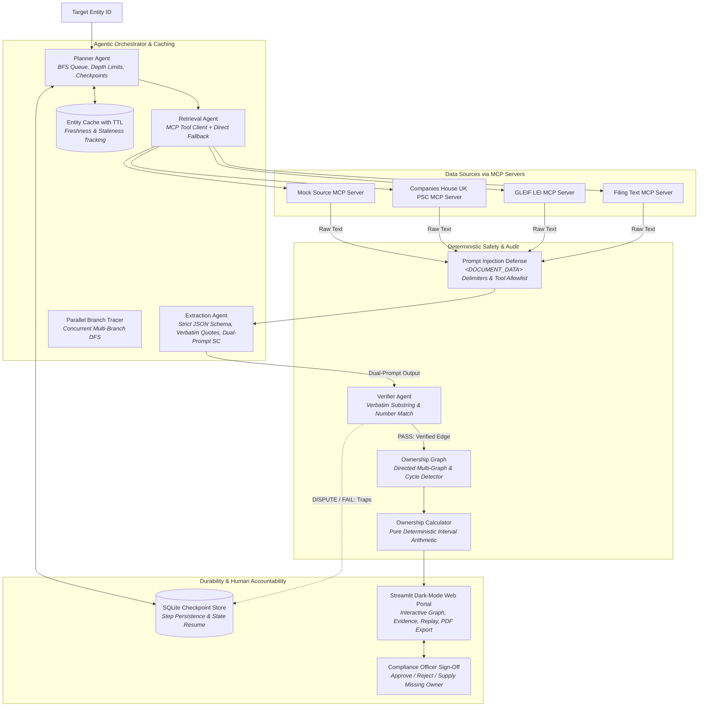

# System Architecture & Design: UBO Tracer

## 1. Executive Design Overview

The **UBO Tracer** is a hybrid deterministic-agentic system designed to uncover Ultimate Beneficial Owners (UBOs) across complex multi-jurisdictional corporate structures. It combines the structured reasoning, fuzzy language extraction, and tool-dispatching flexibility of Large Language Models (LLMs) with the absolute precision and auditability of **exact deterministic interval arithmetic**.

---

## 2. Component Responsibilities

| Component | Responsibility | Nature | Error Handling & Safeguards |
| :--- | :--- | :--- | :--- |
| **`llm.py`** | Thin Ollama HTTP client with JSON enforcement | Probabilistic | Retry on JSON decode error; fails loudly if Ollama or model is missing |
| **`sources/`** | Retrieves corporate registry records and raw filings | I/O Retrieval | Gracefully falls back if keys or network are unavailable; mock mode works fully offline |
| **`retrieval.py`** | Decides next best source based on entity jurisdiction/type | Hybrid | LLM recommendation with deterministic priority fallback order |
| **`extraction.py`** | Extracts corporate edges, owner types, and control flags | LLM | Strictly barred from doing arithmetic; must provide exact verbatim quotes |
| **`verifier.py`** | Validates quotes and grounding of numbers | Exact Code | Discards any edge whose quote is not in document or number is not in quote |
| **`planner.py`** | Manages exploration queue and stop criteria | Deterministic | Hard limits: max 8 depth, max 40 steps, max 2 retries; breaks cycles |
| **`calculator.py`** | Multi-path multiplication and interval summation | Exact Code | Pure Python interval arithmetic; classifies `ABOVE`, `BELOW`, `UNCERTAIN` |
| **`report.py`** | Renders full auditor breakdown with human sign-off block | Deterministic | Formats formulas, evidence quotes, and flags non-ownership control |

---

## 3. Where Knowledge Lives

1. **In Code (Deterministic & Immutable)**:
   - Arithmetic formulas: $\text{Effective Ownership} = \sum_{\text{paths}} \prod_{e \in \text{path}} \text{pct}(e)$.
   - Interval arithmetic: $[ \sum \prod \text{lower}, \sum \prod \text{upper} ]$.
   - Threshold classification logic (`gt` vs `gte`).
   - Quote substring matching and number grounding.
   - Cycle detection and step limits.

2. **In Retrieval & LLM (Probabilistic & Adaptive)**:
   - Understanding messy regulatory filing prose (e.g. "holds indirectly through its wholly owned subsidiary").
   - Extracting control rights (trustee status, veto rights, board appointment powers) without conflating them into economic ownership.

3. **In the Human Reviewer (Accountable Decision-Maker)**:
   - Reviewing dead ends (`UNRESOLVED`).
   - Reviewing borderline or band intervals (`UNCERTAIN`).
   - Assessing non-ownership control mechanisms (trusts, voting rights).
   - Signing off on final regulatory filings.

---

## 4. Non-Negotiable Design Rules Addressed

1. **The LLM never does arithmetic**: All multiplications, path sums, and interval bounds are calculated strictly in `OwnershipCalculator`.
2. **Edge Grounding**: Every edge contains `owner_id`, `owned_id`, `percentage_min`, `percentage_max`, `document_id`, and `quote`.
3. **Verifier Gate**: Unverified edges are permanently dropped from the graph and appended to `rejected_edges`.
4. **No Guessing**: Dead ends emit `UNRESOLVED` and require human review.
5. **Control vs Ownership**: Voting rights, board control, and trustee powers are stored in `ControlNature` and reported as flags, never merged into equity percentages.
6. **Interval Arithmetic & Thresholds**: Percentages support ranges. Intervals crossing the threshold are classified `UNCERTAIN`.
7. **Cycle Handling**: BFS/DFS tracks visited paths, breaks loops, and flags circular relationships for audit.
8. **Synthetic Labeling**: All benchmark scenarios are explicitly marked synthetic.

---

## 5. Alternatives Considered and Rejected

### A. Single LLM Call Over All Documents
- **Why Rejected**: Corporate ownership in real-world investigations involves dozens of documents across multiple jurisdictions discovered dynamically. Dumping all documents into an LLM context window causes severe hallucinations, context dilution, and arithmetic mistakes.

### B. LLM Doing Arithmetic
- **Why Rejected**: LLMs are autoregressive token predictors and inherently struggle with fractional multiplications (e.g., $60\% \times 50\% = 30\%$, or combining parallel branches). Financial compliance requires 100% auditable deterministic arithmetic.

### C. Fully Rule-Based / Regex Extraction
- **Why Rejected**: Filing text in unstructured filings is messy ("approximately one-quarter", "indirectly via nominee", "wholly owned subsidiary"). Pure regex fails on linguistic nuances and phrasing variations. LLMs excel at extraction when constrained by a verifier.

### D. Heavy Agent Frameworks (LangChain / CrewAI)
- **Why Rejected**: Heavy frameworks introduce massive dependency graphs, hidden abstractions, nondeterministic prompt mutations, and unpredictable execution loops that are hard to audit or explain to compliance regulators. A clean plain-Python agent loop ensures full transparency.

### E. Agent-to-Agent Autonomous Chat Protocols
- **Why Rejected**: Having agents converse back-and-forth in unstructured English creates cascading prompt entropy, non-reproducible emergent behaviors, and unbounded token loops. A deterministic BFS planner calling schema-constrained extraction steps provides auditability and reproducibility.

### F. Multi-Agent Freeform Debate
- **Why Rejected**: In legal and compliance investigations, consensus by rhetorical debate is legally dangerous; two LLMs can easily convince each other of a hallucinated beneficial owner. Instead, we use deterministic dual-prompt self-consistency: if two extractions disagree on numbers or owners, the edge is flagged as `DISPUTED` and referred to a human officer.

### G. Long-Term Vector Store Memory
- **Why Rejected**: Corporate ownership facts are time-sensitive, statutory, and jurisdictional. Long-term vector embeddings blur temporal boundaries (e.g., mixing a 2021 filing with a 2026 restructuring) and cannot reliably capture exact percentage equations. We instead use an explicit SQLite entity cache with discrete TTL timestamps and source provenance dates.

---

## 6. Weakest Points & Mitigations

1. **Entity Resolution / Disambiguation**:
   - *Risk*: Multiple entities sharing similar names in free text.
   - *Mitigation*: Fallback to exact company registration numbers and LEIs; flag ambiguous matches for human review.
2. **Local LLM Inference Speed**:
   - *Risk*: Local CPU/GPU inference latency on consumer laptops.
   - *Mitigation*: Thin prompt format, format="json", low context windows, and cached document lookups.
3. **Complex Cross-Holdings with Partial Cycles**:
   - *Risk*: Linear algebra or matrix inversion might be theoretically required for infinite geometric series in circular holdings.
   - *Mitigation*: The system detects the cycle, breaks traversal at the cycle boundary, outputs the primary direct path, and flags the circular holding with high priority for human legal review.

